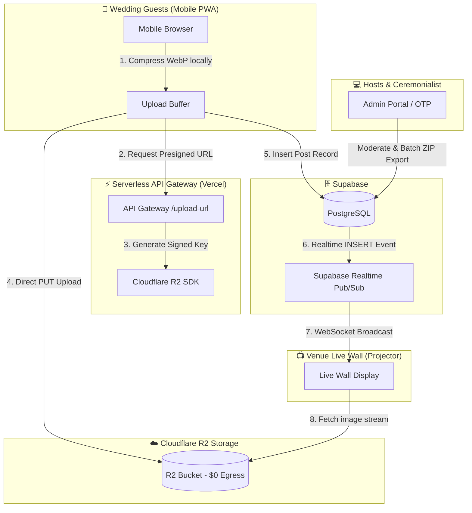

# 💍 InstaWedding T&P

<p align="center">
  <strong>Interactive Realtime Photo Wall & Progressive Web App for Weddings</strong>
  <br />
  <em>Crafted with love to celebrate the wedding of Thiago & Priscila</em>
</p>

<p align="center">
  
  
  
  
  
  
  
  
</p>

---

## 📖 Overview

**InstaWedding T&P** is a high-performance Progressive Web App (PWA) designed to elevate the guest experience at Thiago & Priscila's wedding.

Built around **frictionless guest onboarding**, attendees join instantly by scanning a QR Code placed on their tables—no app store downloads, complicated sign-ups, or password walls required. Guests capture moments, complete engaging "Photo Scavenger Hunt" challenges, leave heartfelt messages, and watch their memories stream **live onto the venue's projector/display wall in realtime** powered by WebSockets.

---

## ✨ Key Features

### 📱 Guest Experience (Mobile PWA)

- **Zero-Friction Access:** Simple guest identification by name/nickname (or optional Google OAuth login).
- **Client-Side Compression:** Images are compressed to optimized WebP format directly in the guest's browser before upload, preserving mobile data plans.
- **Direct Cloud Uploads (Presigned URLs):** Photos are uploaded straight from the browser to Cloudflare R2 via secure presigned PUT URLs, bypassing intermediate server bottlenecks.
- **Resilient Offline Queue:** If the venue's Wi-Fi or cellular network drops, photos are safely stored locally in IndexedDB and synchronized automatically once connectivity is restored.
- **Fine-Art Filters:** Elegant in-app photography filters available during photo capture.
- **Digital Guestbook:** Warm personal messages and wishes attached to photo memories.

### 📺 Live Projector Wall (Display Mode)

- **Realtime Streaming:** Connected directly to Supabase Realtime (WebSockets) to broadcast photos to the big screen within seconds of capture.
- **Fine-Art Aesthetic:** Bento Grid layout inspired by fine-art wedding albums with tasteful animations and elegant typography.
- **Screen WakeLock:** Integrates with the browser's WakeLock API to prevent the venue screen/projector from going into sleep mode during the event.

### 🏆 Photo Scavenger Hunt (Challenges)

- Gamified missions to spark guest interactions (e.g., _"Photo with the smiling couple"_, _"Best dance floor move"_, _"Most lively toast"_).

### 🛡️ Admin & Ceremonialist Dashboard

- **Secure Authentication:** Passwordless OTP (One-Time Password) sent via email using Resend, backed by cryptographically signed HTTP-only JWT cookies.
- **Live Content Moderation:** Hosts and ceremonial staff can review, approve, hide, or remove inappropriate posts in real time.
- **Batch ZIP Export:** Download all original, high-resolution photos bundled into a single `.zip` archive for the couple's permanent archive.

### ⚖️ Privacy & Compliance (LGPD)

- Transparent terms of service, explicit consent modal, and guest self-service deletion option for photos and personal data.

---

## 🏛️ System Architecture



---

## 🛠️ Tech Stack & Ecosystem

| Layer               | Technology                                                                     | Purpose                                                                         |
| :------------------ | :----------------------------------------------------------------------------- | :------------------------------------------------------------------------------ |
| **Frontend**        | [React 19](https://react.dev/) + [TypeScript](https://www.typescriptlang.org/) | Declarative, component-driven UI with strict end-to-end type safety             |
| **Build Tool**      | [Vite 8](https://vite.dev/)                                                    | Lightning-fast bundling and instant Hot Module Replacement (HMR)                |
| **Styling**         | [Tailwind CSS v4](https://tailwindcss.com/)                                    | Modern atomic CSS engine with zero-config Vite integration                      |
| **Routing**         | [React Router DOM v7](https://reactrouter.com/)                                | Fluid client-side SPA routing across Feed, Capture, Challenges, Wall, and Admin |
| **Database**        | [Supabase](https://supabase.com/) (PostgreSQL)                                 | Structured data persistence (posts, challenges, likes, moderation status)       |
| **Realtime Engine** | [Supabase Realtime](https://supabase.com/realtime)                             | WebSocket pub/sub for instantaneous projector and feed updates                  |
| **Media Storage**   | [Cloudflare R2](https://www.cloudflare.com/developer-platform/r2/)             | High-performance, S3-compatible object storage with **$0 egress fees**          |
| **Email & OTP**     | [Resend](https://resend.com/)                                                  | Transactional email delivery for administrator login verification codes         |
| **Hosting & CI/CD** | [Vercel](https://vercel.com/)                                                  | Global edge distribution and Node.js serverless functions                       |
| **Code Quality**    | [Oxlint](https://oxc.rs/) + [Prettier](https://prettier.io/)                   | Next-generation ultra-fast linting and opinionated code formatting              |

---

## 🚀 Getting Started Locally

### Prerequisites

- **Node.js** 20+ (recommended: Node 22 or 26 LTS)
- **npm**
- Linux/WSL or macOS/Windows terminal

### 1. Clone the repository

```bash
git clone https://github.com/thienry/instawedding.git
cd instawedding
```

### 2. Install dependencies

```bash
npm install
```

### 3. Configure Environment Variables

Create a `.env.local` file in the project root (reference `.env.example`):

```bash
cp .env.example .env.local
```

Fill in your service credentials:

```env
# Supabase
VITE_SUPABASE_URL="https://your-project.supabase.co"
VITE_SUPABASE_ANON_KEY="your-publishable-or-anon-key"
SUPABASE_SERVICE_ROLE_KEY="your-secret-or-service-role-key"

# Cloudflare R2
R2_ACCOUNT_ID="your-account-id"
R2_ACCESS_KEY_ID="your-access-key-id"
R2_SECRET_ACCESS_KEY="your-secret-access-key"
R2_BUCKET_NAME="instawedding"
R2_PUBLIC_DOMAIN="https://media.your-domain.com"

# Admin Dashboard
ADMIN_EMAILS="groom@email.com,bride@email.com,coordinator@email.com"
ADMIN_JWT_SECRET="generate-a-secure-string-with-openssl-rand-hex-32"

# Resend (Email OTP)
RESEND_API_KEY="re_your_resend_key"
RESEND_FROM_EMAIL="onboarding@resend.dev"
```

> 💡 **Tip:** If the project is linked to Vercel, pull all production environment variables with:
>
> ```bash
> npx vercel env pull --environment=production .env.local
> ```

### 4. Start the local development server

```bash
npm run dev
```

Open your browser at `http://localhost:5173`. To test on a mobile phone on the same Wi-Fi network, use the network IP address printed in the terminal.

---

## 📜 Available Scripts

| Script         | Command                | Description                                                     |
| :------------- | :--------------------- | :-------------------------------------------------------------- |
| `dev`          | `npm run dev`          | Starts Vite dev server with LAN exposure (`--host`)             |
| `build`        | `npm run build`        | Typechecks (`tsc -b`) and generates production build in `dist/` |
| `preview`      | `npm run preview`      | Locally serves the production build for testing                 |
| `check`        | `npm run check`        | Typecheck, lint, tests and formatting; prints only failures     |
| `lint`         | `npm run lint`         | Fast static code analysis using Oxlint                          |
| `format`       | `npm run format`       | Formats all source files with Prettier                          |
| `format:check` | `npm run format:check` | Verifies code formatting conformance without modifying files    |

---

## 🗄️ Project Structure

```text
instawedding/
├── api/                    # Vercel Serverless Functions (Upload, Auth, Moderation)
│   ├── _lib/               # Security utilities, JWT handlers, and crypto helpers
│   └── admin/              # Administrative endpoints (Auth, OTP, Moderation)
├── docs/                   # Architecture specs and deployment documentation
├── public/                 # Favicons, vector icons, PWA manifest, and sitemap
├── src/
│   ├── components/
│   │   ├── capture/        # Capture modal, camera view, photo filters, and guestbook
│   │   ├── common/         # Shared UI (Avatar, Lightbox modal, Error boundary)
│   │   └── layout/         # Bottom navigation bar, floating actions, and app shell
│   ├── hooks/              # Custom hooks (WakeLock, Inactivity, Offline queue, Realtime)
│   ├── pages/              # Primary views (Feed, Capture, Challenges, Projector, Admin)
│   ├── services/           # Service & repository layer (Supabase, R2, Contracts, Mocks)
│   ├── types/              # Domain-wide TypeScript type definitions
│   └── utils/              # Client-side image compression, photo filters, session helpers
├── supabase/               # PostgreSQL schemas, RLS policies, and migrations
├── vercel.json             # Vercel deployment headers and routing rules
└── vite.config.ts          # Vite build configuration and plugins
```

---

## 📄 License

Distributed under the **MIT** License.

<p align="center">
  Specially crafted to celebrate the love of <strong>Thiago & Priscila</strong> 🥂❤️
</p>
