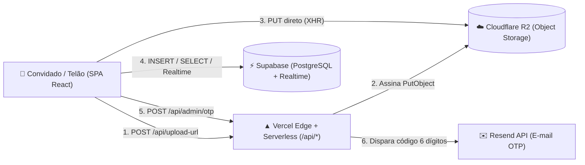

# Guia de Deploy em Produção — InstaWedding

Este documento detalha o provisionamento completo da infraestrutura e o deploy da aplicação **InstaWedding** do zero até a validação em produção.

---

## 1. Visão Geral da Arquitetura em Produção



### Componentes
- **Frontend SPA**: React 19 + Vite (`src/App.tsx`)
- **Serverless API**: Vercel Functions em `api/upload-url.ts`, `api/admin/otp.ts`, `api/admin/auth.ts` e `api/admin/logout.ts`
- **Banco de Dados & Realtime**: Supabase PostgreSQL (`supabase/schema.sql`)
- **Armazenamento de Fotos**: Cloudflare R2 (`src/services/r2/r2-storage.service.ts`)
- **Autenticação Admin/Cerimonial**: E-mail OTP via Resend + Cookie `HttpOnly` assinado via HMAC-SHA256 (`api/_lib/security.ts`)

---

## 2. Pré-requisitos

1. **Node.js 20+** instalado na sua máquina local (o deploy será feito direto via **Vercel CLI**, sem precisar de GitHub).
2. Conta no [Supabase](https://supabase.com) (plano Free atende).
3. Conta na [Cloudflare](https://dash.cloudflare.com) com **R2** habilitado (10 GB/mês gratuitos).
4. Conta no [Resend](https://resend.com) (3.000 e-mails/mês gratuitos).
5. Conta na [Vercel](https://vercel.com) (você pode criar conta com e-mail ou Google, sem GitHub).

---

## 3. Passo 1 — Configurar o Banco de Dados (Supabase)

### 3.1. Criar o Projeto
1. Acesse o [Supabase Dashboard](https://supabase.com/dashboard) e clique em **New Project**.
2. Escolha a região mais próxima do evento (ex.: **South America (São Paulo) - `sa-east-1`**).
3. Defina uma senha forte para o banco e aguarde o provisionamento (~2 minutos).

### 3.2. Executar o Schema SQL e Seeds
1. No menu lateral do projeto no Supabase, abra **SQL Editor** e clique em **New query**.
2. Copie todo o conteúdo do arquivo `supabase/schema.sql` deste repositório, cole no editor e clique em **Run**.
3. O script criará automaticamente:
   - Tabelas `challenges`, `posts` e `likes` com índices otimizados.
   - Funções RPC `increment_likes` e `decrement_likes`.
   - Políticas de Row Level Security (RLS).
   - Publicação `supabase_realtime` na tabela `posts` (necessária para atualização instantânea no Feed e no Telão `/projector`).
   - Os 5 desafios iniciais da festa.

### 3.3. Coletar a URL e as Chaves do Supabase (Novo Painel)
O painel do Supabase separou a URL e as chaves em menus diferentes. Você pode pegá-las de duas formas:

- **Forma Rápida (Botão `Connect` no topo da tela)**:
  1. Na barra superior do projeto, clique no botão **`Connect`**.
  2. Na aba **`App Frameworks`** (React / Vite), copie a URL do projeto e a chave pública.
- **Pelo Menu `Project Settings` (ícone de engrenagem na barra lateral esquerda)**:
  1. **URL do Projeto (`VITE_SUPABASE_URL` e `SUPABASE_URL`)**:
     - Acesse **`Project Settings` > `Data API`**.
     - Em **Project URL**, copie a URL `https://<project-ref>.supabase.co`.
  2. **Chaves de API (`VITE_SUPABASE_ANON_KEY` e `SUPABASE_SERVICE_ROLE_KEY`)**:
     - Acesse **`Project Settings` > `API Keys`**.
     - Você pode usar tanto as chaves novas (**Publishable key** `sb_publishable_...` e **Secret key** `sb_secret_...`) quanto clicar na aba **`Legacy API Keys`** para copiar a **`anon` `public`** (`eyJ...`) e a **`service_role` `secret`** (`eyJ...`). Ambas são suportadas pelo `@supabase/supabase-js`.

> **Atenção**: Nunca coloque a chave `service_role` / `sb_secret_...` em variáveis prefixadas com `VITE_`. Qualquer variável com prefixo `VITE_` é embutida no bundle público do navegador.

---

## 4. Passo 2 — Configurar Armazenamento de Mídia (Cloudflare R2)

### 4.1. Criar o Bucket
1. No painel da [Cloudflare](https://dash.cloudflare.com), acesse **R2 Object Storage > Overview** e clique em **Create bucket**.
2. Nomeie o bucket (ex.: `instawedding-bucket`).
3. Em **Location**, selecione **Automatic**.

### 4.2. Habilitar Acesso de Leitura e Conectar ao Domínio da Vercel (`/media/*`)
Para usar o próprio domínio gratuito `.vercel.app` com **Cache na CDN da Vercel** e evitar o rate-limit do `r2.dev` sem gastar com domínio próprio:
1. Abra o bucket criado e vá na aba **Settings**.
2. Em **Public Development URL (`r2.dev`)**, clique em **Allow Access** (já configurado no `vercel.json` com `https://pub-0d40d8c10eb24e8388e286f86efcdb44.r2.dev`):
   ```json
   {
     "source": "/media/:path*",
     "destination": "https://pub-0d40d8c10eb24e8388e286f86efcdb44.r2.dev/:path*"
   }
   ```
4. Na variável de ambiente `R2_PUBLIC_DOMAIN`, use apenas `/media` (assim todas as fotos serão servidas via `https://seu-projeto.vercel.app/media/uploads/...` com cache imutável na Edge da Vercel).

### 4.3. Configurar Política CORS no Bucket
Como o navegador do convidado faz o `PUT` da imagem diretamente para o Cloudflare R2 usando a Presigned URL, o CORS é obrigatório:

1. Ainda em **Bucket > Settings**, role até **CORS Policy** e clique em **Add CORS policy**.
2. Cole o JSON abaixo (substituindo pelo seu domínio da Vercel):

```json
[
  {
    "AllowedOrigins": [
      "https://seu-projeto.vercel.app",
      "http://localhost:5173"
    ],
    "AllowedMethods": ["GET", "PUT", "HEAD"],
    "AllowedHeaders": ["Content-Type"],
    "ExposeHeaders": ["ETag"],
    "MaxAgeSeconds": 3600
  }
]
```

### 4.4. Gerar Credenciais S3 do R2
1. Volte para **R2 Object Storage > Overview** e clique em **Manage R2 API Tokens**.
2. Clique em **Create API token**:
   - **Permissions**: `Object Read & Write`.
   - **Specify bucket(s)**: selecione apenas `instawedding-bucket`.
3. Copie e guarde os valores gerados:
   - **Account ID** -> `R2_ACCOUNT_ID`
   - **Access Key ID** -> `R2_ACCESS_KEY_ID`
   - **Secret Access Key** -> `R2_SECRET_ACCESS_KEY`

---

## 5. Passo 3 — Configurar Envio de E-mail OTP (Resend)

O painel administrativo (`/admin`) autentica noivos e cerimonialistas enviando um código descartável de 6 dígitos por e-mail via `api/admin/otp.ts`.

1. Acesse o [Resend Dashboard](https://resend.com).
2. **Domínio Remetente**:
   - Em **Domains**, adicione seu domínio próprio (ex.: `seucasamento.com.br`) e configure os registros DNS (DKIM/SPF) indicados, **ou** utilize `onboarding@resend.dev` caso vá autenticar apenas com o mesmo e-mail titular da conta Resend.
   - Defina `RESEND_FROM_EMAIL` (ex.: `InstaWedding <onboarding@resend.dev>`).
3. Em **API Keys**, clique em **Create API Key** (permissão `Sending access`) e copie a chave `re_...` para `RESEND_API_KEY`.

---

## 6. Passo 4 — Deploy Direto da Máquina Local (Vercel CLI — Sem GitHub)

### 6.1. Autenticar e Vincular o Projeto via Terminal
No terminal do Windows PowerShell, dentro da pasta `D:\personal-projects\instawedding`, execute:

```powershell
# 1. Autentica na sua conta da Vercel (abrirá o navegador para confirmar)
npx.cmd vercel login

# 2. Cria o projeto na Vercel vinculado à sua pasta local
npx.cmd vercel link
```

Responda às perguntas do `npx.cmd vercel link`:
- **Set up `"D:\personal-projects\instawedding"`?** -> `Y`
- **Which scope should contain your project?** -> Selecione sua conta
- **Link to existing project?** -> `N`
- **What’s your project’s name?** -> `instawedding`
- **In which directory is your code located?** -> `./` (apenas pressione Enter)
- **Want to modify these settings?** -> `N`

### 6.2. Configurar as Variáveis de Ambiente na Vercel
1. Acesse o painel web da [Vercel](https://vercel.com/dashboard), clique no projeto **`instawedding`** recém-criado e vá em **Settings > Environment Variables**.
2. Cadastre todas as chaves abaixo marcando os ambientes **Production** e **Preview** (ou use o botão **Import .env**):

| Variável | Exemplo / Valor | Escopo |
| :--- | :--- | :--- |
| `VITE_USE_MOCKS` | `false` | Frontend Build |
| `ADMIN_EMAILS` | `noivo@gmail.com,noiva@gmail.com` | Serverless API |
| `MODERATOR_EMAILS` | `cerimonial@gmail.com,assessoria@gmail.com` | Serverless API |
| `VITE_ADMIN_EMAILS` | `noivo@gmail.com,noiva@gmail.com` | Frontend Build |
| `VITE_MODERATOR_EMAILS` | `cerimonial@gmail.com,assessoria@gmail.com` | Frontend Build |
| `VITE_SUPABASE_URL` | `https://xyzcompany.supabase.co` | Frontend Build |
| `VITE_SUPABASE_ANON_KEY` | `eyJhbGciOiJIUzI1NiIsInR5c...` | Frontend Build |
| `SUPABASE_URL` | `https://xyzcompany.supabase.co` | Serverless API |
| `SUPABASE_SERVICE_ROLE_KEY` | `eyJhbGciOiJIUzI1NiIsInR5c...` | Serverless API |
| `ADMIN_JWT_SECRET` | String hex aleatória de 64 caracteres | Serverless API |
| `RESEND_API_KEY` | `re_123456789...` | Serverless API |
| `RESEND_FROM_EMAIL` | `InstaWedding <onboarding@resend.dev>` | Serverless API |
| `R2_ACCOUNT_ID` | `a1b2c3d4e5f6...` | Serverless API |
| `R2_ACCESS_KEY_ID` | `9f8e7d6c5b4a...` | Serverless API |
| `R2_SECRET_ACCESS_KEY` | `1a2b3c4d5e6f7g8h...` | Serverless API |
| `R2_BUCKET_NAME` | `instawedding-bucket` | Serverless API |
| `R2_PUBLIC_DOMAIN` | `/media` | Serverless API |

Para gerar um `ADMIN_JWT_SECRET` criptograficamente seguro no terminal:
```powershell
node -e "console.log(require('crypto').randomBytes(32).toString('hex'))"
```

### 6.3. Publicar em Produção e Ajustar o CORS do R2
1. Com as variáveis salvas no painel da Vercel, volte ao terminal e publique direto da sua máquina:

```powershell
npx vercel --prod
```

2. O comando fará o upload do projeto, executará o build na nuvem da Vercel e exibirá a URL final de produção (`https://instawedding-xxx.vercel.app`).
3. Copie essa URL final e certifique-se de que ela está listada em `AllowedOrigins` na política CORS do bucket Cloudflare R2 (Passo 4.3).
4. Sempre que fizer alguma alteração futura no código local, basta rodar `npx vercel --prod` novamente.

---

## 7. Checklist de Validação Pós-Deploy (Smoke Test)

Execute os 5 testes abaixo após o deploy para garantir que toda a cadeia está operacional:

- [ ] **1. Roteamento Direto (SPA Rewrite)**:
  Acesse diretamente `https://<seu-dominio>/projector` e `https://<seu-dominio>/challenges` em uma aba anônima e confirme que a página carrega sem erro `404`.
- [ ] **2. Leitura dos Desafios (Supabase)**:
  Em `/challenges`, verifique se os 5 desafios iniciais cadastrados pelo `supabase/schema.sql` são listados.
- [ ] **3. Upload de Foto + Moldura/Filtro (R2 + Supabase)**:
  Pelo celular, acesse `/capture`, tire uma foto, aplique um filtro/moldura e publique. Verifique se:
  - A barra de progresso chega a 100%.
  - A foto aparece no Feed (`/`) carregando a partir do domínio `R2_PUBLIC_DOMAIN`.
- [ ] **4. Telão em Tempo Real (Supabase Realtime)**:
  Deixe `/projector` aberto no notebook e publique uma nova foto pelo celular. A foto deve entrar automaticamente no slideshow com o alerta de "Nova Foto" sem precisar recarregar a página.
- [ ] **5. Painel de Moderação (`/admin`)**:
  Acesse `/admin`, solicite o código OTP para um e-mail listado em `ADMIN_EMAILS`, insira o código recebido por e-mail e teste ocultar/aprovar uma postagem.
