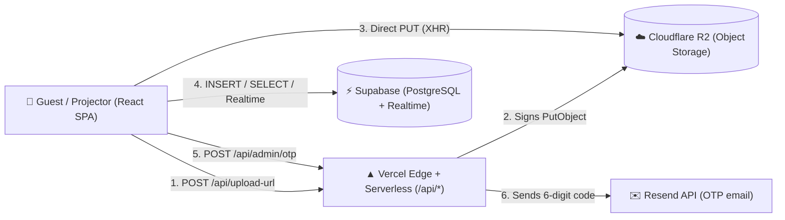

# Production Deployment Guide — InstaWedding

This document covers the full infrastructure provisioning and deployment of **InstaWedding**, from scratch to production validation.

---

## 1. Production Architecture Overview



### Components

- **Frontend SPA**: React 19 + Vite (`src/App.tsx`)
- **Serverless API**: Vercel Functions in `api/upload-url.ts`, `api/admin/otp.ts`, `api/admin/auth.ts`, `api/admin/moderate.ts` and `api/admin/logout.ts`
- **Database & Realtime**: Supabase PostgreSQL (`supabase/migrations/20260101000000_baseline.sql`)
- **Photo Storage**: Cloudflare R2 (`src/services/r2/r2-storage.service.ts`)
- **Admin/Ceremonialist Authentication**: OTP email via Resend + `HttpOnly` cookie signed with HMAC-SHA256 (`api/_lib/security.ts`)

---

## 2. Prerequisites

1. **Node.js 20+** installed on your local machine (deployment is done directly through the **Vercel CLI**, with no GitHub needed).
2. A [Supabase](https://supabase.com) account (the Free plan is enough).
3. A [Cloudflare](https://dash.cloudflare.com) account with **R2** enabled (10 GB/month free).
4. A [Resend](https://resend.com) account (3,000 emails/month free).
5. A [Vercel](https://vercel.com) account (you can sign up with email or Google, without GitHub).

---

## 3. Step 1 — Set Up the Database (Supabase)

### 3.1. Create the Project

1. Open the [Supabase Dashboard](https://supabase.com/dashboard) and click **New Project**.
2. Choose the region closest to the event (e.g. **South America (São Paulo) - `sa-east-1`**).
3. Set a strong database password and wait for provisioning (~2 minutes).

### 3.2. Run the SQL Schema and Seeds

1. In the Supabase project sidebar, open **SQL Editor** and click **New query**.
2. Copy the full contents of `supabase/migrations/20260101000000_baseline.sql` from this repository, paste it into the editor and click **Run**. Then run the remaining migrations in the folder, in order. **Do not rerun the baseline on an existing database.**
3. The script automatically creates:
   - The `challenges`, `posts` and `likes` tables with optimized indexes.
   - The `increment_likes` and `decrement_likes` RPC functions.
   - Row Level Security (RLS) policies.
   - The `supabase_realtime` publication on the `posts` table (required for instant updates in the Feed and on the `/projector` wall).
   - The 5 initial party challenges.
4. Under **Authentication > Providers**, enable **Google**: guests must sign in to post, like and delete.

### 3.3. Collect the Supabase URL and Keys (New Dashboard)

The Supabase dashboard splits the URL and the keys into different menus. You can get them in two ways:

- **Quick way (`Connect` button at the top of the screen)**:
  1. In the project's top bar, click **`Connect`**.
  2. In the **`App Frameworks`** tab (React / Vite), copy the project URL and the public key.
- **Through `Project Settings` (gear icon in the left sidebar)**:
  1. **Project URL (`VITE_SUPABASE_URL` and `SUPABASE_URL`)**:
     - Go to **`Project Settings` > `Data API`**.
     - Under **Project URL**, copy `https://<project-ref>.supabase.co`.
  2. **API keys (`VITE_SUPABASE_ANON_KEY` and `SUPABASE_SERVICE_ROLE_KEY`)**:
     - Go to **`Project Settings` > `API Keys`**.
     - You can use the new keys (**Publishable key** `sb_publishable_...` and **Secret key** `sb_secret_...`) or open the **`Legacy API Keys`** tab to copy the **`anon` `public`** (`eyJ...`) and **`service_role` `secret`** (`eyJ...`) keys. Both are supported by `@supabase/supabase-js`.

> **Warning**: Never put the `service_role` / `sb_secret_...` key in variables prefixed with `VITE_`. Any `VITE_` variable is embedded in the public browser bundle.

---

## 4. Step 2 — Set Up Media Storage (Cloudflare R2)

### 4.1. Create the Bucket

1. In the [Cloudflare](https://dash.cloudflare.com) dashboard, go to **R2 Object Storage > Overview** and click **Create bucket**.
2. Name the bucket (e.g. `instawedding-bucket`).
3. Under **Location**, select **Automatic**.

### 4.2. Enable Read Access and Connect to the Vercel Domain (`/media/*`)

To use the free `.vercel.app` domain with **Vercel CDN caching** and avoid the `r2.dev` rate limit without paying for a custom domain:

1. Open the bucket and go to the **Settings** tab.
2. Under **Public Development URL (`r2.dev`)**, click **Allow Access** (already configured in `vercel.json` with `https://pub-0d40d8c10eb24e8388e286f86efcdb44.r2.dev`):
   ```json
   {
     "source": "/media/:path*",
     "destination": "https://pub-0d40d8c10eb24e8388e286f86efcdb44.r2.dev/:path*"
   }
   ```
3. Set the `R2_PUBLIC_DOMAIN` environment variable to just `/media` (all photos will be served through `https://your-project.vercel.app/media/uploads/...` with immutable caching on the Vercel Edge).

### 4.3. Configure the Bucket CORS Policy

CORS is required because the guest's browser sends the image `PUT` directly to Cloudflare R2 using the presigned URL:

1. Still in **Bucket > Settings**, scroll to **CORS Policy** and click **Add CORS policy**.
2. Paste the JSON below (replacing it with your Vercel domain):

```json
[
  {
    "AllowedOrigins": [
      "https://your-project.vercel.app",
      "http://localhost:5173"
    ],
    "AllowedMethods": ["GET", "PUT", "HEAD"],
    "AllowedHeaders": ["Content-Type"],
    "ExposeHeaders": ["ETag"],
    "MaxAgeSeconds": 3600
  }
]
```

### 4.4. Generate R2 S3 Credentials

1. Go back to **R2 Object Storage > Overview** and click **Manage R2 API Tokens**.
2. Click **Create API token**:
   - **Permissions**: `Object Read & Write`.
   - **Specify bucket(s)**: select only `instawedding-bucket`.
3. Copy and store the generated values:
   - **Account ID** -> `R2_ACCOUNT_ID`
   - **Access Key ID** -> `R2_ACCESS_KEY_ID`
   - **Secret Access Key** -> `R2_SECRET_ACCESS_KEY`

---

## 5. Step 3 — Set Up OTP Email Delivery (Resend)

The admin dashboard (`/admin`) authenticates the couple and ceremonialists by emailing a disposable 6-digit code through `api/admin/otp.ts`.

1. Open the [Resend Dashboard](https://resend.com).
2. **Sender domain**:
   - Under **Domains**, add your own domain (e.g. `yourwedding.com`) and configure the listed DNS records (DKIM/SPF), **or** use `onboarding@resend.dev` if you will only authenticate with the Resend account owner's email.
   - Set `RESEND_FROM_EMAIL` (e.g. `InstaWedding <onboarding@resend.dev>`).
3. Under **API Keys**, click **Create API Key** (`Sending access` permission) and copy the `re_...` key to `RESEND_API_KEY`.

---

## 6. Step 4 — Deploy Directly from the Local Machine (Vercel CLI — No GitHub)

### 6.1. Authenticate and Link the Project from the Terminal

In Windows PowerShell, inside the `D:\personal-projects\instawedding` folder, run:

```powershell
# 1. Sign in to your Vercel account (opens the browser to confirm)
npx.cmd vercel login

# 2. Create the Vercel project linked to your local folder
npx.cmd vercel link
```

Answer the `npx.cmd vercel link` questions:

- **Set up `"D:\personal-projects\instawedding"`?** -> `Y`
- **Which scope should contain your project?** -> Select your account
- **Link to existing project?** -> `N`
- **What’s your project’s name?** -> `instawedding`
- **In which directory is your code located?** -> `./` (just press Enter)
- **Want to modify these settings?** -> `N`

### 6.2. Configure Environment Variables on Vercel

1. Open the [Vercel](https://vercel.com/dashboard) web dashboard, click the newly created **`instawedding`** project and go to **Settings > Environment Variables**.
2. Add all the keys below for the **Production** and **Preview** environments (or use the **Import .env** button):

| Variable                    | Example / Value                             | Scope          |
| :-------------------------- | :------------------------------------------ | :------------- |
| `VITE_USE_MOCKS`            | `false`                                     | Frontend Build |
| `ADMIN_EMAILS`              | `groom@gmail.com,bride@gmail.com`           | Serverless API |
| `MODERATOR_EMAILS`          | `ceremonialist@gmail.com,planner@gmail.com` | Serverless API |
| `VITE_ADMIN_EMAILS`         | `groom@gmail.com,bride@gmail.com`           | Frontend Build |
| `VITE_MODERATOR_EMAILS`     | `ceremonialist@gmail.com,planner@gmail.com` | Frontend Build |
| `VITE_SUPABASE_URL`         | `https://xyzcompany.supabase.co`            | Frontend Build |
| `VITE_SUPABASE_ANON_KEY`    | `eyJhbGciOiJIUzI1NiIsInR5c...`              | Frontend Build |
| `SUPABASE_URL`              | `https://xyzcompany.supabase.co`            | Serverless API |
| `SUPABASE_SERVICE_ROLE_KEY` | `eyJhbGciOiJIUzI1NiIsInR5c...`              | Serverless API |
| `ADMIN_JWT_SECRET`          | Random 64-character hex string              | Serverless API |
| `RESEND_API_KEY`            | `re_123456789...`                           | Serverless API |
| `RESEND_FROM_EMAIL`         | `InstaWedding <onboarding@resend.dev>`      | Serverless API |
| `R2_ACCOUNT_ID`             | `a1b2c3d4e5f6...`                           | Serverless API |
| `R2_ACCESS_KEY_ID`          | `9f8e7d6c5b4a...`                           | Serverless API |
| `R2_SECRET_ACCESS_KEY`      | `1a2b3c4d5e6f7g8h...`                       | Serverless API |
| `R2_BUCKET_NAME`            | `instawedding-bucket`                       | Serverless API |
| `R2_PUBLIC_DOMAIN`          | `/media`                                    | Serverless API |

To generate a cryptographically secure `ADMIN_JWT_SECRET` in the terminal:

```powershell
node -e "console.log(require('crypto').randomBytes(32).toString('hex'))"
```

### 6.3. Publish to Production and Adjust R2 CORS

1. With the variables saved in the Vercel dashboard, go back to the terminal and publish directly from your machine:

```powershell
npx vercel --prod
```

2. The command uploads the project, runs the build in the Vercel cloud and prints the final production URL (`https://instawedding-xxx.vercel.app`).
3. Copy that URL and make sure it is listed under `AllowedOrigins` in the Cloudflare R2 bucket CORS policy (Section 4.3).
4. Whenever you change the local code later, just run `npx vercel --prod` again.

---

## 7. Post-Deploy Validation Checklist (Smoke Test)

Run the 5 tests below after deploying to make sure the whole chain works:

- [ ] **1. Direct Routing (SPA Rewrite)**:
      Open `https://<your-domain>/projector` and `https://<your-domain>/challenges` directly in an incognito tab and confirm the page loads without a `404` error.
- [ ] **2. Challenge Reads (Supabase)**:
      In `/challenges`, check that the 5 initial challenges created by `supabase/migrations/20260101000000_baseline.sql` are listed.
- [ ] **3. Photo Upload + Frame/Filter (R2 + Supabase)**:
      On a phone, open `/capture`, take a photo, apply a filter/frame and publish it. Check that:
  - The progress bar reaches 100%.
  - The photo appears in the Feed (`/`) and loads from the `R2_PUBLIC_DOMAIN` domain.
- [ ] **4. Realtime Projector (Supabase Realtime)**:
      Keep `/projector` open on a laptop and publish a new photo from a phone. The photo must join the slideshow automatically, with the "Nova Foto" alert, without reloading the page.
- [ ] **5. Moderation Dashboard (`/admin`)**:
      Open `/admin`, request the OTP code for an email listed in `ADMIN_EMAILS`, enter the code received by email and test hiding/approving a post.

---

## 8. Event Day Checklist

- [ ] Print the table signs with the QR Code and challenge instructions.
- [ ] Test uploads over 4G at the venue.
- [ ] Connect the computer to the projector and open `/projector` in full screen (F11).
- [ ] Delete the test posts before the party starts.
